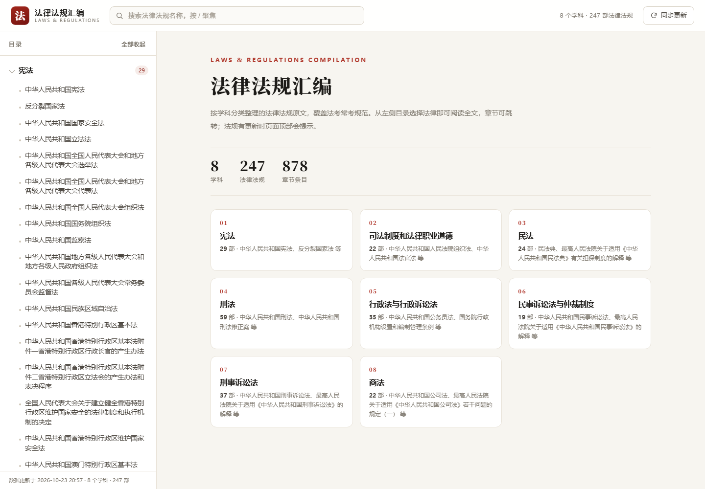
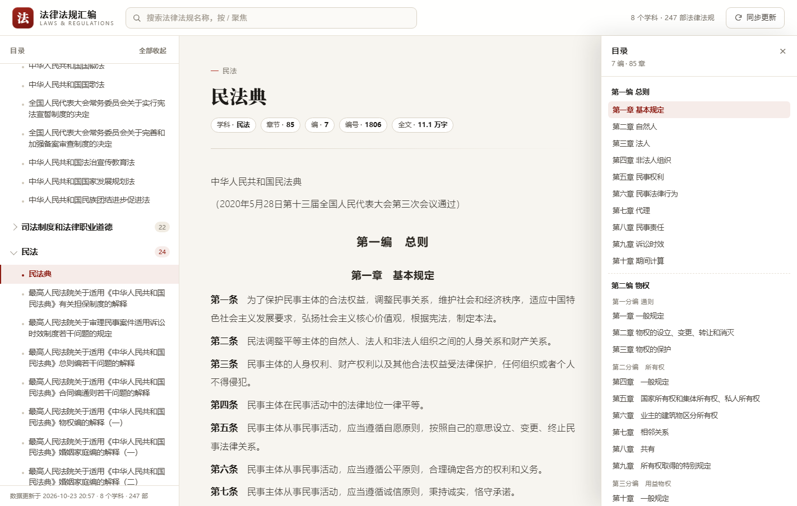
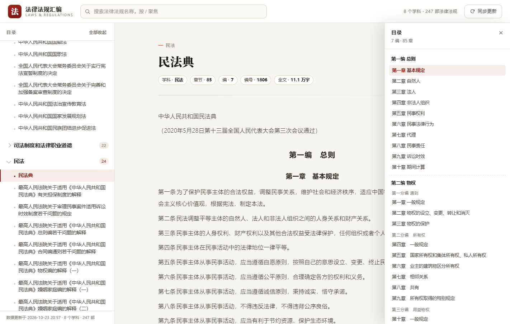

# 法律法规汇编

按学科分类的法律法规站点：左侧目录，右侧全文阅读；数据来自
[竹马 · 法律法规汇编](https://www.zhumavip.com/w/fvhuibian?businessType=104&legalQuestionType=1&mineType=)，支持一键 / 定时同步。

当前收录：**8 个学科 / 247 部法律法规 / 1033 个章节 / 187 万字**（约 5.7 MB）。



## 快速开始（本机）

```bat
start.bat          :: 或 python server.py
```

浏览器打开 `http://127.0.0.1:8123`。服务自带后台同步线程：启动补跑一次，之后每天检查一次版本。

手机访问：start.bat 启动时已监听局域网，用它打印的「手机用这个」地址在手机浏览器打开即可（详见 [DEPLOY.md](DEPLOY.md#15-手机访问局域网--外网)）。



## 部署到手机 / 线上

完整步骤见 **[DEPLOY.md](DEPLOY.md)**，三种方式共用同一套同步逻辑：

| 方式 | 页面 | 更新触发 | 点击更新 | 费用 |
| --- | --- | --- | --- | --- |
| 本机 | `server.py` | 服务内置定时 | ✅ | 0 |
| GitHub + Pages | Pages | GitHub Actions（每天 06:00） | 需配 Worker | 0 |
| Cloudflare Pages + Worker | Pages | Actions + Worker 兜底 | ✅ | 0 |

## 架构：一个核心 + 三个入口

```
tools/sync.py                      核心：查版本 → 拉目录 → diff → 拉正文 → 写盘
   ├─ 入口 1  python tools/sync.py --once      ← 计划任务 / GitHub Actions / 任何 CI
   ├─ 入口 2  POST /api/update                 ← server.py（本机、VPS）
   └─ 入口 3  Cloudflare Worker                ← 静态托管下的按钮（转触发 Actions）
```

同步逻辑与触发方式解耦：换部署平台只改「谁调用它」，`tools/sync.py` 不动。

一次同步做什么：

1. 查 `lawVersion`，和 `data/sync-state.json` 比 —— **没变就 1 秒结束**；
2. 变了才拉目录 `listV2`，按 `id` 比出新增 / 下架 / 改名 / 换学科；
3. 拉正文（8 个学科各 1 次请求，约 3 秒），按法律拆成 `data/laws/<id>.json`；
4. 原子写入，写 `last-update.json` 与 `changelog/YYYY-MM-DD.json`；
5. 失败则整批放弃，不会留下半套数据。

## 目录结构

```
law/
├─ index.html                  页面骨架
├─ server.py                   本地服务 + /api/status、/api/update + 后台定时
├─ start.bat                   一键启动（本机 + 局域网，手机可访问）
├─ assets/
│  ├─ config.js                站点配置（同步接口地址、轮询时长）
│  ├─ app.js                   目录、搜索、阅读器、同步交互
│  └─ styles.css
├─ data/
│  ├─ catalog.json / catalog.js        目录：学科 → 法律 → 章节数
│  ├─ laws/<lawId>.json                正文：章节 + 条文
│  ├─ content-manifest.json            正文清单（哈希 / 章节 / 字数）
│  ├─ sync-state.json                  上次同步的版本号
│  ├─ last-update.json                 上次同步结果
│  ├─ changelog/YYYY-MM-DD.json        变更记录
│  ├─ heartbeat.json                   心跳时间戳（防 60 天无提交被暂停）
│  └─ source-listV2.json               目录原始树（含编 / 分编）
├─ tools/
│  ├─ sync.py                  核心同步（目录 + 正文）
│  ├─ fetch_source.py          只抓原始目录树
│  ├─ build_catalog.py         构建 / 比对 / 写盘
│  └─ heartbeat.py             每月写一次时间戳，保持仓库活跃
├─ cloudflare/
│  ├─ worker.js                按钮代理 → GitHub Actions
│  └─ wrangler.toml
├─ .github/workflows/sync.yml  每天自动同步
└─ docs/                       预览截图
```

## 功能

- **目录**：8 学科手风琴，记住展开状态；「全部展开 / 收起」
- **阅读器**：细体正文、无首行缩进，章节标题加粗；右侧悬浮「目录」按钮弹出 编 / 分编 / 章 结构，支持 `#/law/1806/ch/1855` 深链定位
- **搜索**：按法律法规名称过滤，命中高亮，`/` 聚焦、`Esc` 清空，`?q=民法典` 带词打开
- **同步**：一键 / 定时；有更新时按钮亮红点；同步后自动刷新数据与页脚时间
- **AI 提问**：点条文编号（如「第五百六十三条」）自动复制「法条 + 提问模板」并打开配置的 AI 站点，粘贴即可提问（不调用任何 API）
- **移动端**：≤860px 侧栏转抽屉，正文按需加载单部法；搜索框聚焦时自动展开



## 数据来源

```
GET  /api/laws/listV2                        目录树
POST /api/laws/info   {"id": 学科id}          该学科全部章节正文（纯文本）
GET  /api/office/laws/lawVersion             目录版本号
```

节点类型：`0` 学科、`1` 法律（带编章）、`2` 编、`3` 分编、`4` 章（正文挂在叶子上）。
深度为 1 且 `type=4` 的是不分章节的单篇法律（如《反分裂国家法》）。

> 实测 `businessType`、`legalQuestionType`、`mineType` 传任何值返回都相同，均为这 8 个学科。

## 命令行速查

```bat
python server.py                       :: 启动（含后台自动同步）
python server.py --no-auto-sync        :: 不自动同步
python server.py --bind 0.0.0.0        :: 允许局域网访问
python server.py --update-only         :: 同步一次后退出

python tools/sync.py --once            :: 同上（CI / 计划任务）
python tools/sync.py --check           :: 只比较版本号
python tools/sync.py --once --force    :: 忽略版本号强制重抓
python tools/sync.py --once --dry-run  :: 抓取但不写盘

python tools/heartbeat.py --force      :: 手动更新心跳（防定时任务被暂停）
```

## 注意

- 正文为源站公开条文文本，仅作学习检索；官方核对请自行对照 [国家法律法规数据库](https://flk.npc.gov.cn/)，流程里不做自动校验。
- 部署细节、故障排查、Worker 配置见 [DEPLOY.md](DEPLOY.md)。


